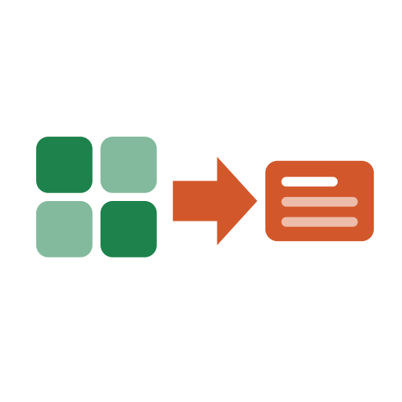

<div align="center">

<picture>
  <source media="(prefers-color-scheme: dark)" srcset="assets/logo-dark.svg">
  
</picture>

# Delivery Reporting Tools

**Spreadsheets in, decks, emails and dashboards out.**<br>
Single-file browser tools for delivery work. No server, no install, no data leaving your machine.

[](https://github.com/cdtm88/xlsx2pptx/actions/workflows/check.yml)


[Tools](#-tools) · [Quick start](#-quick-start) · [Report Kit](#-report-kit-and-design) · [Contributing](#-contributing) · [Full guides](docs/tools.md)

</div>

---

## ✨ Why

| 📄 **One file** | 🔒 **Private by design** | ⚡ **Instant** | 🎨 **Consistent** |
|:---:|:---:|:---:|:---:|
| Each tool is a single `.html` with every library inlined. | A strict CSP blocks every network request. Data stays local. | Open from disk and go. No build, login or setup. | Shared Report Kit, so every tool looks and works alike. |

## 🧰 Tools

| | Tool | What it does |
|:---:|---|---|
| 📊 | [**Delivery Plan**](delivery-plan.html) | Turns an Excel delivery plan into a PowerPoint Gantt chart. |
| 📨 | [**Waqti Exceptions**](waqti-exceptions.html) | Checks a Waqti timesheet export against approved demands and drafts the correction email. |
| 🗂️ | [**Waqti Demand Summary**](waqti-demand-summary.html) | Summarises a Waqti export as hours per demand, person and feature. |
| 💷 | [**Project Cost Tracker**](project-cost-tracker.html) | Tracks a project's spend, burn-up and forecast against its estimate. |
| 🗓️ | [**PI Planning Capacity**](pi-planning-capacity.html) | Works out each team's real sprint capacity for a PI after leave and holidays. |
| 🧾 | [**Vendor Spend Tracker**](vendor-spend-tracker.html) | Tracks vendor estimates, POs and invoices against annual budgets. |
| ✅ | [**UAT Sign-off Tracker**](uat-signoff-tracker.html) | Tracks UAT results, defects and approvals to sign-off, and drafts the stakeholder update email. |
| ✉️ | [**UAT Email Builder**](uat-email-builder.html) | Builds the UAT stakeholder update or sign-off request from figures and a status you type in. |

> [!TIP]
> Every option, rule and edge case for each tool is covered in [`docs/tools.md`](docs/tools.md).

## 🚀 Quick start

1. **Download** the `.html` file you need.
2. **Open** it in Chrome, Edge, Firefox or Safari.
3. **Drop in** your spreadsheet, or start from scratch.

That's it. Works from `file://` with the network switched off.

## 🎨 Report Kit and design

Every tool is built on the **Report Kit**, a shared foundation in
[`framework/`](framework/README.md) that keeps the tools looking and behaving
the same.

| Part | What it is |
|---|---|
| [`report-kit-2.css`](framework/report-kit-2.css) | The current design language: header, stat cards, tables, dialogs, drawer and chips. |
| [`report-kit.js`](framework/report-kit.js) | Shared runtime (`window.RK`): file loading, clipboard, storage, dialogs, sorting and the rules JSON module. |
| [`DESIGN.md`](framework/DESIGN.md) | Principles, tokens, components and a checklist for new tools. |
| [`starter.src.html`](framework/starter.src.html) | A small working page to copy when starting a new tool. |
| [`report-kit.css`](framework/report-kit.css) | Kit 1, frozen. Kept for older tools; not for new ones. |

**Design principles:** answer first · numbers in mono · colour only for status ·
quiet chrome · keyboard accessible · offline enforced.
[Vendor Spend Tracker](vendor-spend-tracker.html) is the reference implementation.

## 🔧 Contributing

The shipped `.html` files are built from `reports/*.src.html` and the Report
Kit. Don't edit them by hand.

```sh
python3 framework/build.py          # rebuild every tool
python3 framework/build.py --check  # verify built files are current
node tests/smoke.cjs                # headless smoke test (needs Playwright)
```

CI runs both checks on every pull request. New tools start from the starter page
and follow [`DESIGN.md`](framework/DESIGN.md).

<details>
<summary><b>📁 Repository layout</b></summary>
<br>

| Path | Contents |
|---|---|
| `*.html` | The built tools, ready to open |
| `reports/` | Source for each tool |
| `framework/` | Report Kit, vendored libraries and the build script |
| `docs/` | Tool guides, rules and design notes |
| `tests/` | Smoke test and fixtures |
| `assets/` | Logos, favicon and the blank delivery-plan Excel template |
| `BACKLOG.md` | Known bugs and refactors, prioritised |

</details>
